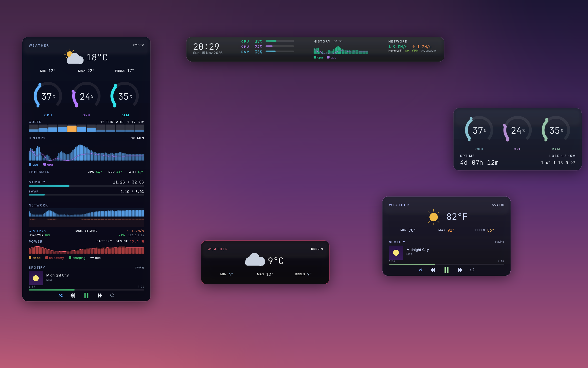
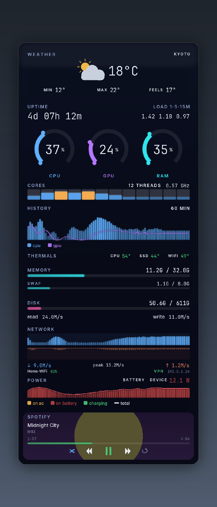
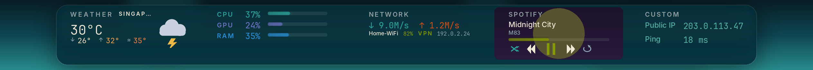
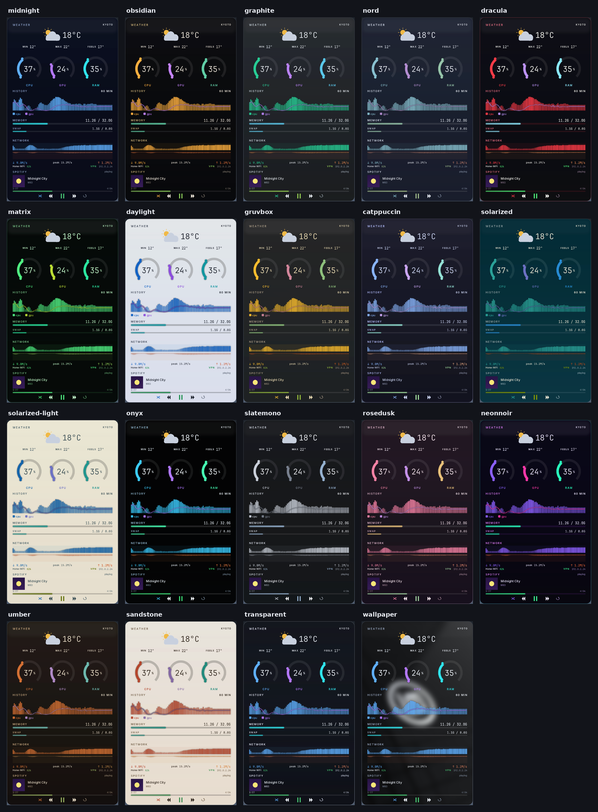
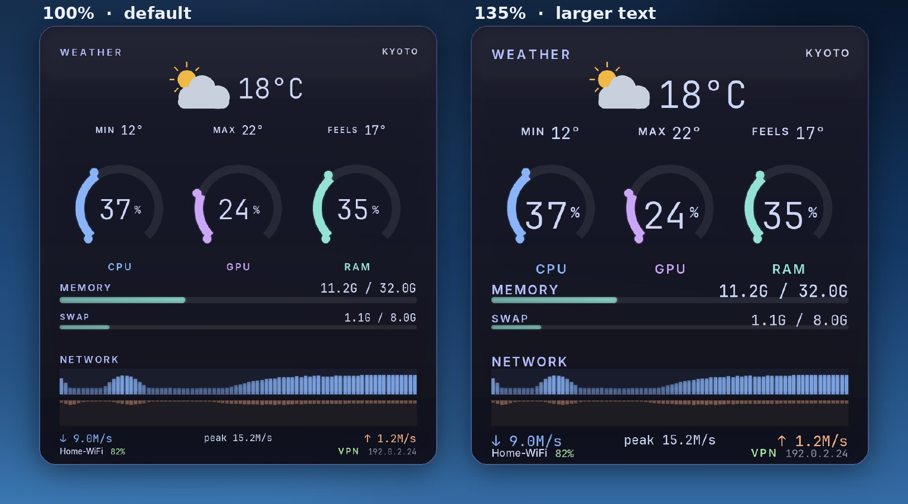
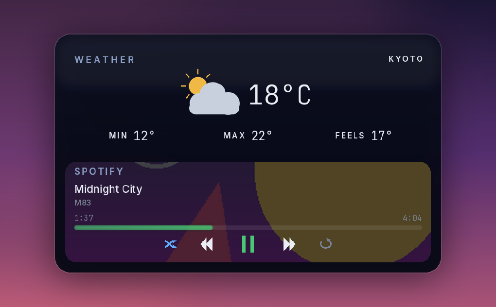
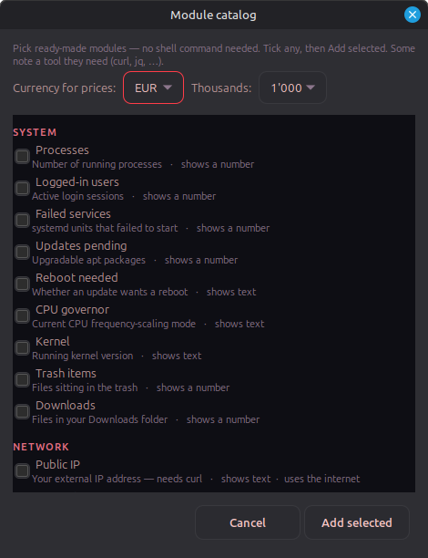
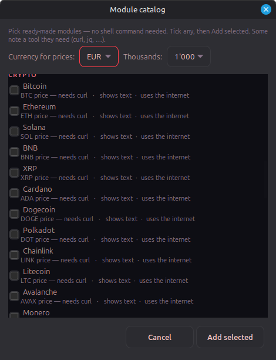
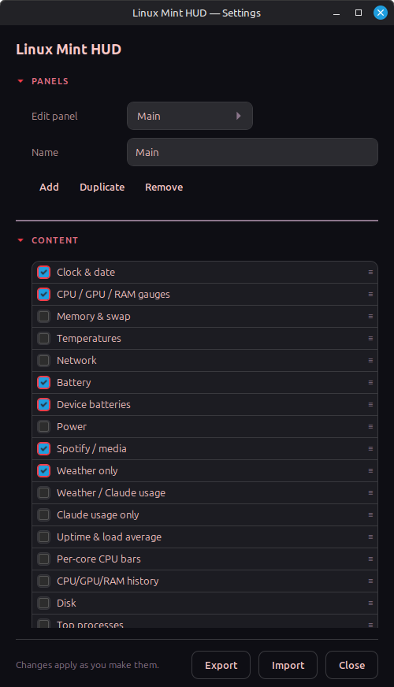
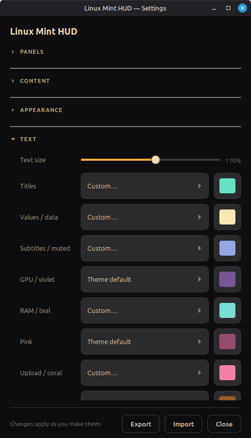

# linux-mint-hud

**Your machine's vitals, living on the desktop itself.** CPU, GPU, RAM,
thermals, network, power, weather and now-playing — painted as translucent glass
panels that sit below your windows, follow you to every workspace, and let every
click fall straight through to the desktop underneath. Place them where you like,
theme them how you like.

Built for Linux Mint (Cinnamon / X11). No widget engine, no config files to
hand-edit — one Python file renders each panel with Pillow and paints it into a
GTK/cairo desktop window.

> **Version 2.0** — horizontal top-bar panels, per-role text colours and text
> sizing, album-cover Spotify cards, multi-city weather, a crypto/stocks module
> catalog, and 19 themes. [See what's new ↓](#whats-new-in-20)



---

## Documentation

| Guide | What's in it |
|---|---|
| [Installation guide](docs/installation.md) | Every install method, requirements, autostart, updating and uninstalling |
| [App guide — features & settings](docs/guide.md) | Every section, theme, appearance and settings option explained |
| [Custom modules](docs/custom-modules.md) | The four module types, the catalog, the currency picker, examples |
| [Tray menu](docs/tray.md) | The mini tray menu: show/hide, alerts, settings, quit |
| [FAQ](docs/faq.md) | Is it safe? Does it phone home? Wayland? Multiple monitors? Performance? |
| [Changelog](CHANGELOG.md) | The full 1.1 → 2.0 history |

---

## What it shows

Each panel is a stack of **sections**. Every one can be switched off and dragged
into any order, so a panel shows exactly what you care about and nothing else.

- **Top slot** — Claude plan quota, the weather, or alternating between the two.
- **Claude quota** — session and weekly usage, per-model limits (Opus and
  friends), with reset times.
- **Weather** — a hand-drawn sky icon, temperature, and the day's min / max /
  feels-like. Per-panel location(s) and °C/°F.
- **Clock** — time and date, with 12/24h, seconds and date-format options.
- **Uptime & load** — the 1, 5 and 15-minute load averages.
- **CPU / GPU / RAM** — ring gauges, a per-core strip, and an hour of history.
- **Thermals** — temperatures on one line on a green-to-red gradient, with
  friendly renameable names.
- **Memory, swap & disk** — one disk by default, or several chosen mounts.
- **Network** — download above the axis, upload below; SSID, signal, local IP
  and a VPN tag.
- **Power & battery** — device draw (and wall draw while charging), charge,
  direction and voltage.
- **Devices** — the battery of a wireless mouse, keyboard or headset. A device
  you add stays on the panel shown *disconnected* while it's off and returns on
  its own, so nothing jumps around.
- **Spotify / media** — now-playing with the album cover as the module
  background, a progress bar and clickable transport controls.
- **Top processes** — the top three by CPU and by memory.
- **Custom modules** — your own shell commands, or ready-made ones from the
  catalog.



## As many panels as you like

Run one, or run a dozen. **Add** a fresh panel with every section on, or
**Duplicate** the current one as a true auto-named copy. Each panel keeps its
**own** sections, order, disks, sensors, devices, temperature unit, weather
location(s), size, position, theme and appearance — so you can build a full
readout down one side, a compact gauge cluster in a corner, and a glance-panel
for a second city, each tuned independently. Put one on a second monitor.

*Move panel…* lets you drag a panel anywhere — it stays where you drop it — and
drag the corner grip to resize. Width is yours to set; height follows the
content, and dragging a panel taller spreads its sections apart. True WYSIWYG.

## A thin top bar, too *(new in 2.0)*

Flip **Horizontal layout** on any panel and it lays itself out as a thin bar
across the top of the screen — sections arranged left-to-right in a compact
form with stable fixed column widths, so it never reflows as values change. An
ideal always-on status bar.




## 19 themes, tuned to the pixel

Every panel picks its own **theme** — Midnight (default), Obsidian, Graphite,
Nord, Dracula, Matrix, Daylight, Gruvbox, Catppuccin, Solarized, Solarized
Light, Onyx, Slate Mono, Rose Dusk, Neon Noir, Umber, Sandstone, Transparent
and Wallpaper. **Transparent** shows the desktop straight through; **Wallpaper**
frosts your actual desktop background (or an image you choose).



Then fine-tune the look per panel in the **Appearance** group: background mode
(glass / solid / transparent / image), accent colour (preset or custom),
opacity, corner rounding, outline strength, top-edge glow, text contrast, and a
background image with blur, zoom (down to 5%) and tiling. The whole-panel
**Size** slider scales fonts, gauges and layout together. Switch theme and the
new theme's look is adopted while your accent, image and size stay put.

### Text, your way *(new in 2.0)*

A dedicated **Text** group, per panel:

- **Text size** — a 75–140% scale that resizes *just the lettering*,
  independent of the panel Size, for readability from across the room.
- **Per-role text colours** — a picker each (preset / custom / theme default)
  for Titles, Values, Subtitles, and the data accent colours (GPU, RAM, Upload,
  Good, Alerts, Warning, Critical and more). Each follows the theme until you
  override it.



## Now playing, as a cover

The Spotify / media section paints the **album cover as the module background** —
darkened, with the track, artist, progress bar and five transport controls
(shuffle, previous, play/pause, next, repeat) on top, all clickable. When
nothing's playing it quietly shows *Spotify closed*. Works in both the vertical
and horizontal layouts.



## Weather, per panel *(now multi-city)*

The panel detects your location on first run and shows the local weather right
away — from open-meteo, no API key. Per panel you can add **several** cities and
have the panel rotate through them on a timer; US cities default to °F
automatically, and the location name can be hidden. Two panels, two cities,
side by side.

## Claude plan quota

The Claude section shows your claude.ai plan usage — session and weekly, with
per-model limits and reset times. It reads this straight from claude.ai using
your **browser session cookie** (Firefox and forks, or Chromium-family
browsers), so there are no keys or passwords to enter — just stay logged in.
The cookie is cached locally only (`~/.config/mint-hud/.claude_web_cookie`,
mode 600) and never leaves your machine except to claude.ai. With no Claude
login, the slot simply shows the weather instead. Manual setup is covered in
[docs/claude-cookie.md](docs/claude-cookie.md).

## Custom modules

A *module* is a shell command, and the panel shows its output — so it can
display almost anything a command can report. Four output types:

- **Text** — the command's first line, as-is.
- **Number** — the first number in the output.
- **Bar** — the first number (0–100) drawn as a bar.
- **JSON** — a `{"text": "...", "percentage": 0-100}` object (the waybar shape),
  driving a label and a bar from one script.

Commands run off the render loop with a timeout, so a slow command never freezes
the panel. The Custom modules section is **off by default** — an imported config
never runs a command until you turn it on. Modules run with your own
permissions, so only add commands you trust.

**Browse catalog…** is the quick way in: ready-made modules you just tick and
add, grouped into System, Network, Hardware & power, Audio, **Crypto**,
**Stocks**, **Indices**, **Forex & metals** and Homelab & desktop. Crypto
(Bitcoin, Ethereum, Solana, XRP and more) plus a Fear & Greed index, major
stocks, indices, FX pairs and metals all come preconfigured from free, no-key
sources (CoinGecko and Yahoo Finance). A currency picker and thousands-separator
style apply to the crypto prices. Modules that need a tool you don't have
(curl, pamixer, brightnessctl, kubectl, …) are greyed out, and anything the
panel already shows natively isn't duplicated here.





A few things modules can show:

| Shows | Type | Command |
|---|---|---|
| Public IP | Text | `curl -s ifconfig.me` |
| `/home` usage | Bar | `df --output=pcent /home \| tail -1 \| tr -dc 0-9` |
| Running processes | Number | `ps -e --no-headers \| wc -l` |
| Bitcoin price | Text | `curl -s "https://api.coingecko.com/api/v3/simple/price?ids=bitcoin&vs_currencies=chf" \| grep -oE '[0-9]+' \| head -1` |

See the [custom-modules guide](docs/custom-modules.md) for the full catalog,
intervals, per-panel ordering and security notes.

## Everything from one window

The panel itself is click-through, so you drive it from a **system-tray icon** —
show/hide all panels, mute alerts, open settings, visit the project page, report
a bug, or quit. ([Tray menu →](docs/tray.md))

Settings is one scrollable window, each group foldable, and **changes apply as
you make them** — live, no restart. Per-panel groups cover Panels, Content,
Appearance, Text, Position & size, Weather, Clock, Temperatures, Disks, Device
batteries and Custom modules; global groups below an "applies to all panels"
divider cover gauge names, alerts and the custom-module library.





## What's new in 2.0

The previous public release was 1.1. Highlights of 1.1 → 2.0 (full list in the
[changelog](CHANGELOG.md)):

**New**
- **Horizontal panels** — a thin top-of-screen status bar, sections left-to-right.
- **Per-role text colours** and a **text-size scale** that resizes just the lettering.
- **Album cover as the Spotify background** (vertical and horizontal), plus a
  "Spotify closed" state.
- **Multi-city weather** — several rotating locations per panel; US cities default to °F.
- **Custom-module catalog overhaul** — new Crypto / Stocks / Indices / Forex &
  metals sections (free, no key), a crypto currency picker, and more
  System / Audio / Hardware / Homelab modules.
- **Tray menu** — show/hide panels and mute alerts.
- **More themes** (now 19) with a full palette overhaul, background-image
  zoom and tiling, and a 30%-opacity Transparent theme.

**Improved** — a move & resize overhaul with reliable, true-WYSIWYG placement;
theme switching that adopts the new theme's look while keeping your accent,
image and size; tighter non-reflowing horizontal columns; and a settings polish.

**Fixed** — Add/Duplicate panel buttons that did nothing, Spotify transport
buttons not clickable in horizontal layout, weather rotation and sizing glitches,
the background-image picker not opening, and a batch of resize bugs.

## Installing

**The easy way — download and double-click.** Grab the latest `.deb` from the
[**Releases page**](https://github.com/Versifft/linux-mint-hud/releases/latest)
and open it; the Software Installer sets everything up, and the panel and its
settings window open by themselves when it's done.

**Prefer a one-liner?** This clones the app and runs a graphical installer:

```
bash <(curl -fsSL https://raw.githubusercontent.com/Versifft/linux-mint-hud/main/bootstrap.sh)
```

Either way it adds a **Linux Mint HUD — Settings** entry to your application
menu, and the panel autostarts at login. If you installed the `.deb`, updates
arrive through Linux Mint's **Update Manager** like any other package — nothing
to download by hand, and your settings are never touched.

Full instructions, requirements, updating and uninstalling are in the
**[installation guide](docs/installation.md)**.

## How it's built

There's no separate widget engine. `hud.py` is the whole thing: it samples the
metrics from `/proc` and `/sys`, lays each panel out, renders it with Pillow,
and paints it into a GTK/cairo desktop window. Rates are deltas against the
previous frame, so there's no sampling delay, and each panel is drawn natively
at its chosen width, staying crisp at any size.

It adapts to the hardware it finds — CPU temperature from `coretemp`/`k10temp`
or a thermal zone, GPU load from Intel/AMD DRM counters or `nvidia-smi`, power
from whichever RAPL domain is readable. What a machine can't report simply drops
out. Written for Linux Mint (Cinnamon) on **X11** — the tested target; it should
work on other X11 desktops too. Wayland has **experimental** support via
`gtk-layer-shell` (KDE Plasma / wlroots compositors), but it isn't verified yet —
see the [FAQ](docs/faq.md#does-it-work-on-wayland).

## License

MIT — use it, change it, ship it, no warranty. Copyright © 2026 Versifft. See
[LICENSE](LICENSE).
