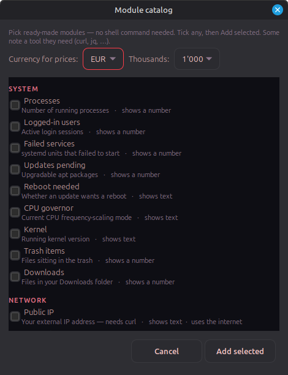
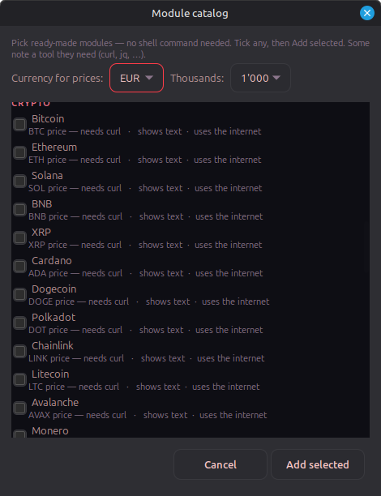
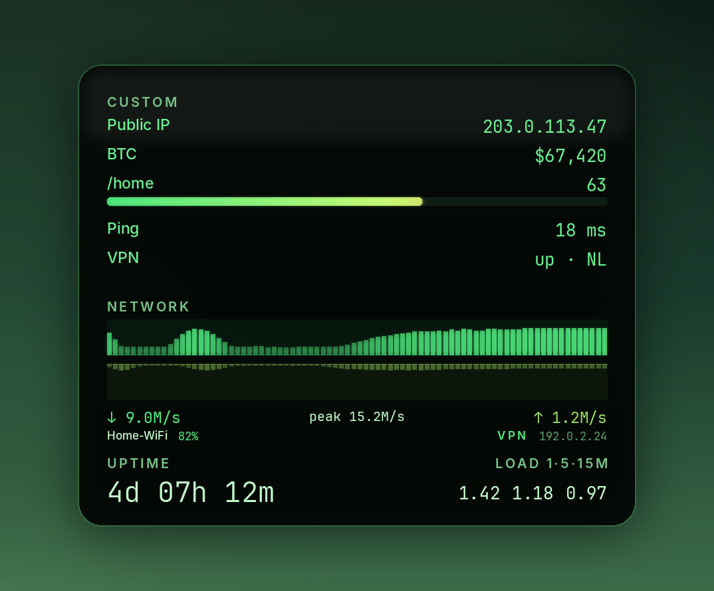

# Custom modules

A **custom module** is a shell command you give the panel; the panel runs it
on a timer and shows the output. This is how linux-mint-hud displays almost
anything that isn't already a built-in section — crypto and stock prices,
server pings, container counts, audio volume, unread mail, whatever a
command can report.

See also: [App guide](guide.md) · [FAQ](faq.md) · [README](../README.md)

## The four module types

Each module has a **label**, a **command**, a **refresh interval** (in
seconds) and a **type**. The type decides how the command's output is
turned into something on the panel:

| Type | What it shows | Expected output |
|---|---|---|
| **Text** | The first line of output, as-is. | Any plain text. |
| **Number** | The first number found in the output. | Text containing a number, e.g. `42%` or `1234`. |
| **Bar** | A bar drawn from the first number 0–100. | A plain number in that range. |
| **JSON** | A label plus a bar, in one module. | `{"text": "...", "percentage": 0-100}` — the same shape [waybar](https://github.com/Alexays/Waybar) modules use. |

The JSON type is handy when a single script should drive both a short label
and a progress indicator, instead of running two separate modules.

## How modules run

- Each module's command runs **off the render loop**, on its own interval,
  with a timeout — a slow or hanging command can't freeze the panel.
- The **Custom modules** section is **off by default**. This matters if you
  import a configuration someone shared with you: none of its commands run
  until you explicitly switch that section on for a panel. See
  [Security](#security) below.
- Selection and order are **per panel** — pick which defined modules appear
  on a given panel, and use the row's **▲ / ▼** buttons to set the order
  they're drawn in. The same module definition can be used on more than one
  panel.

## Defining modules

Custom modules are defined **globally** (Settings → below the "applies to
all panels" divider → **Custom modules**), then switched on per panel:

1. Open **Settings → Custom modules → Add module**.
2. Give it a **label**, the shell **command**, an **interval** in seconds,
   and pick the **type** (Text / Number / Bar / JSON).
3. On each panel where you want it, open that panel's **Custom modules**
   group, turn the section on, and tick the module.

You can also **Export** your custom module definitions to a file and
**Import** someone else's — see [Security](#security) before importing
anything you didn't write yourself.

## The module catalog

Rather than writing commands by hand, **Browse catalog…** opens a list of
ready-made modules grouped by category — tick what you want and add it
directly, with the command already filled in.

| Category | Examples |
|---|---|
| System | Uptime-style and OS-level stats not already shown natively. |
| Network | Public IP and similar network info. |
| Hardware & power | Sensors and power details beyond the built-in gauges. |
| Audio | Volume and related audio status (needs e.g. `pamixer`). |
| Crypto | Bitcoin, Ethereum, Solana, BNB, XRP, Cardano, Dogecoin, Polkadot, Chainlink, Litecoin, Avalanche, Monero, plus a Fear & Greed index. |
| Stocks | Apple, Microsoft, NVIDIA, Tesla, Amazon, Alphabet, Meta, AMD. |
| Indices | S&P 500, Nasdaq, Dow Jones, DAX, FTSE 100, Euro Stoxx 50. |
| Forex & metals | EUR/USD, GBP/USD, USD/JPY, USD/CHF, Gold, Silver, Crude oil. |
| Homelab & desktop | Things like container counts, cluster status, and similar desktop/server checks (needs tools such as `kubectl`, `bluetoothctl`, depending on the module). |

Prices come from free, no-key sources: **CoinGecko** for crypto, **Yahoo
Finance** for stocks, indices, and forex & metals. Nothing in the catalog
requires an account or an API key.

### Currency and number formatting

A **currency picker** (EUR / USD / CHF / …) and a **thousands-separator
style** apply to crypto prices added from the catalog, so the numbers match
how you'd naturally read them.

### Modules that need a tool you don't have

Some catalog modules depend on a command-line tool being installed — `curl`,
`pamixer`, `brightnessctl`, `kubectl`, `bluetoothctl`, and others depending
on the module. If that tool isn't found on your system, the module is
**greyed out** in the catalog so you don't add something that will simply
fail to produce output.

### What's deliberately missing from the catalog

Anything the panel already shows as a built-in section — CPU, GPU, RAM,
disk, network, battery, now-playing media — is **not** duplicated in the
catalog. If you want one of those, use the built-in section instead of a
custom module.

## Security

Custom module commands run **with your own user permissions**, exactly as
if you'd typed them into a terminal yourself. That means:

- **Only add commands you trust.** A custom module is not sandboxed.
- **Review any module from an imported configuration** before switching its
  section on — importing a file doesn't run anything by itself (the Custom
  modules section stays off until you turn it on), but you should still
  read what you're about to enable.
- Catalog modules are maintained as part of the project and point at the
  well-known free APIs listed above; writing your own command is where
  care matters most.

## Example commands

A few modules to get a feel for what's possible, if you want to write your
own rather than use the catalog:

| Shows | Type | Command |
|---|---|---|
| Public IP | Text | `curl -s ifconfig.me` |
| `/home` usage | Bar | `df --output=pcent /home \| tail -1 \| tr -dc 0-9` |
| Running processes | Number | `ps -e --no-headers \| wc -l` |
| Bitcoin price | Text | `curl -s "https://api.coingecko.com/api/v3/simple/price?ids=bitcoin&vs_currencies=chf" \| grep -oE '[0-9]+' \| head -1` |

For the catalog versions of crypto/stock/index/forex modules you don't need
to write anything — pick one from **Browse catalog…** and it comes with its
command already set up.
