# App guide

Everything the panel can show, and every option in the Settings window,
explained. For installing the app see the [installation guide](installation.md);
for custom modules see the [custom modules guide](custom-modules.md); for the
tray icon see the [Tray menu](tray.md). Back to [README](../README.md).

## Opening Settings

There are no config files to hand-edit — everything is a graphical window.
Open **Linux Mint HUD — Settings** from your application menu, or left-click
the [tray icon](tray.md). **Changes apply as you make them** — there's no
"Apply" step and no restart.

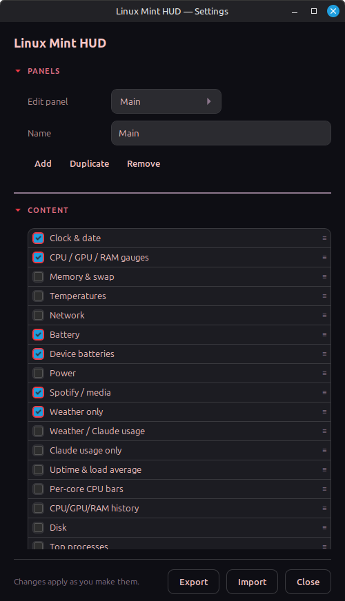

The window is one scrollable page, with each group of options collapsible
("foldable") so you can fold away what you're not touching. Groups split
into two scopes:

- **Per-panel** groups (chosen under **Panels**, via "Edit panel") apply
  only to the panel you're currently editing.
- **Global** groups, below an **"APPLIES TO ALL PANELS"** divider, apply to
  every panel at once (gauge naming, alerts, and the custom-module
  definitions themselves).

**Export**, **Import** and **Close** sit in the action bar at the bottom —
export writes your whole configuration (all panels, all custom module
definitions) to a file, and import reads one back in.

## The panel's sections

Every section below can be switched off, and the ones you keep on can be
dragged into any order, independently on each panel.

| Section | What it shows |
|---|---|
| Top slot | Claude plan quota, the weather, or alternates between the two |
| Claude quota | Session + weekly usage, per-model limits (e.g. Opus), reset times |
| Weather | Hand-drawn sky icon, temperature, day min/max/feels-like |
| Clock | Time and date |
| Uptime & load | 1/5/15-minute load averages |
| CPU / GPU / RAM | Ring gauges, a per-core strip, an hour of history graph |
| Thermals | Temperatures on one line, green→red gradient, renameable |
| Memory, swap & disk | One disk by default, or several chosen mounts |
| Network | Download above the axis, upload below; SSID, signal, local IP, VPN tag |
| Power & battery | Device draw (and wall draw while charging), charge, direction, voltage |
| Devices | Battery of a wireless mouse/keyboard/headset |
| Spotify / media | Now-playing with the album cover as the module background, transport controls |
| Top processes | Top three by CPU, top three by memory |
| Custom modules | Your own shell commands — see the [custom modules guide](custom-modules.md) |

Turn sections on/off and reorder them in the per-panel **Content** group:
tick a section to show it, and drag enabled sections to set the order they
appear in, top to bottom (or left to right in [horizontal layout](#horizontal-layout)).

### Top slot

The top slot is where Claude plan quota and weather live. If you've set up
the Claude quota feature, the slot can alternate between quota and weather
so you get both without spending two sections' worth of space; otherwise it
simply shows weather.

### Claude quota

Shows your claude.ai plan usage — session and weekly usage, including
per-model limits like a separate Opus allowance where your plan has one —
with the times each resets. It reads this straight from claude.ai using your
browser's session cookie; see [Claude quota](#claude-quota-1) below for the
full explanation, and the [FAQ](faq.md#what-about-the-claude-cookie--is-that-private)
for the privacy details.

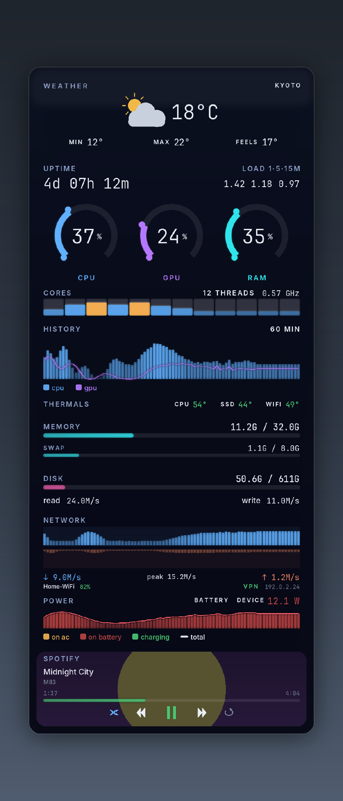

### Weather

A hand-drawn sky icon, the current temperature, and the day's minimum,
maximum and "feels like" values. See [Weather](#weather-1) below for
locations, rotation and units.

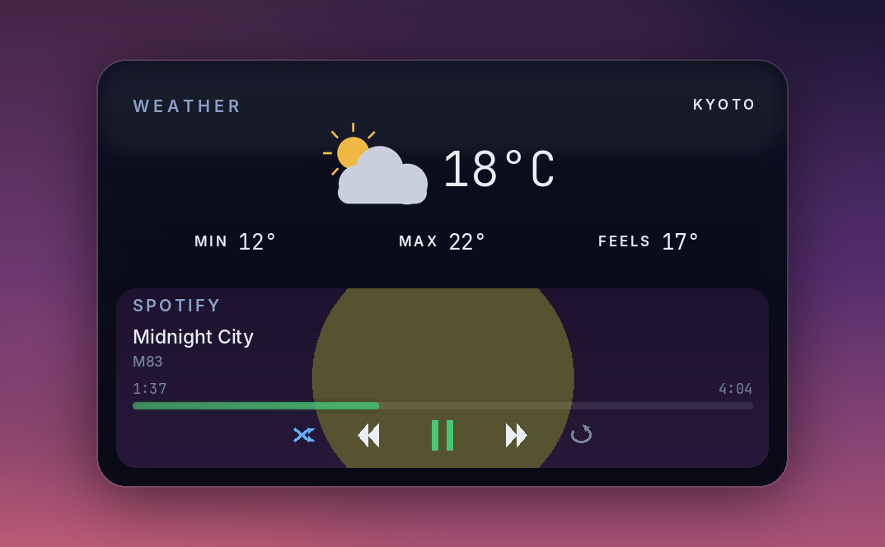

### Clock

Time and date, with the options described under [Clock](#clock-group)
below (12/24-hour, seconds, date format).

### Uptime & load

The system's 1, 5 and 15-minute load averages, plus uptime.

### CPU / GPU / RAM

Ring gauges for CPU, GPU and RAM usage, a strip showing each CPU core
individually, and a rolling hour of history as a graph. GPU load is read
from Intel/AMD DRM counters or `nvidia-smi`, whichever is available; if
neither can report, the GPU gauge simply drops out.

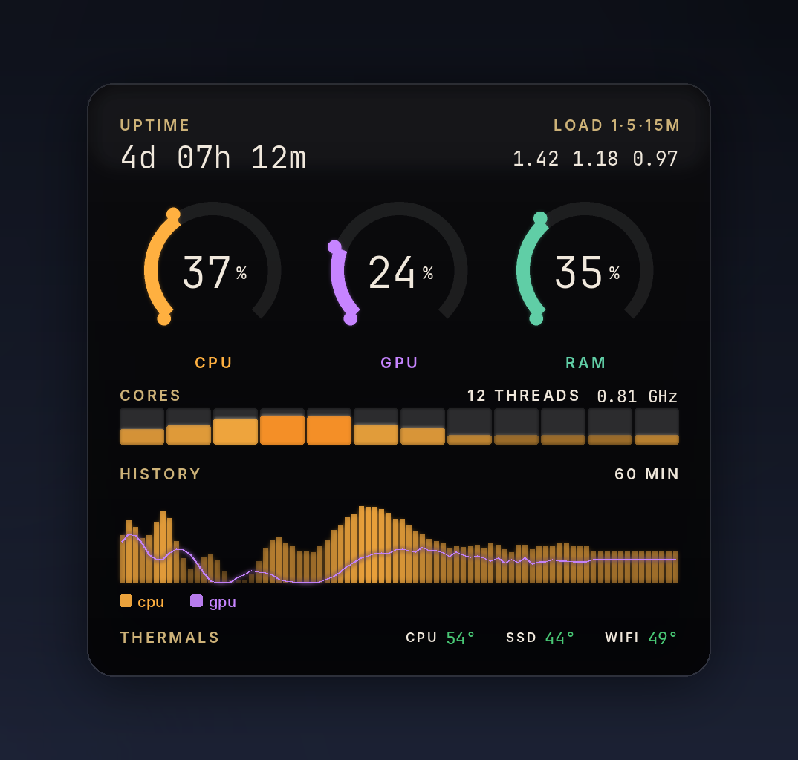

### Thermals

All available temperature sensors on one line, each coloured along a
green-to-red gradient by how hot it is. Sensors get friendly default names
(CPU, SSD, WiFi, GPU, …) that you can rename — see
[Temperatures](#temperatures-group) below.

### Memory, swap & disk

Memory and swap usage, plus disk usage — one disk by default, or several
mounts you choose; see [Disks](#disks-group) below.

### Network

Download speed drawn above the axis, upload below. Also shows the current
Wi-Fi SSID, signal strength, your local IP, and a tag when a VPN is active.

### Power & battery

What the machine is currently drawing, and — while charging — what the wall
is delivering, alongside battery charge, charge/discharge direction, and
voltage.

### Devices

The battery level of wireless peripherals (mouse, keyboard, headset, …).
Once you've added a device it stays on the panel even when it's switched
off or out of range — shown as *disconnected* — and comes back on its own
the moment it reconnects, so the layout never jumps around.

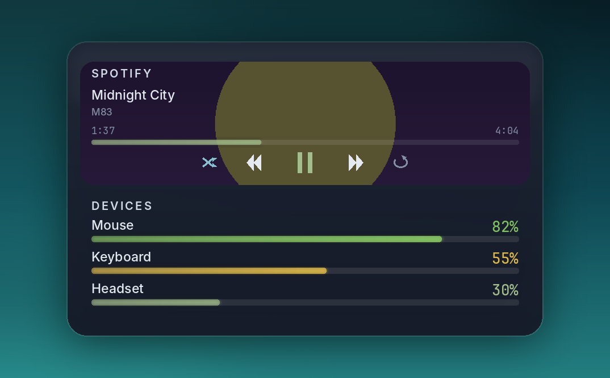

### Spotify / media

Shows what's currently playing, using the **album cover as the module's own
background** (darkened, with the track info written on top), a progress
bar, and five clickable transport controls: shuffle, previous, play/pause,
next, repeat. When nothing is playing, it shows "Spotify closed" instead of
an empty module.

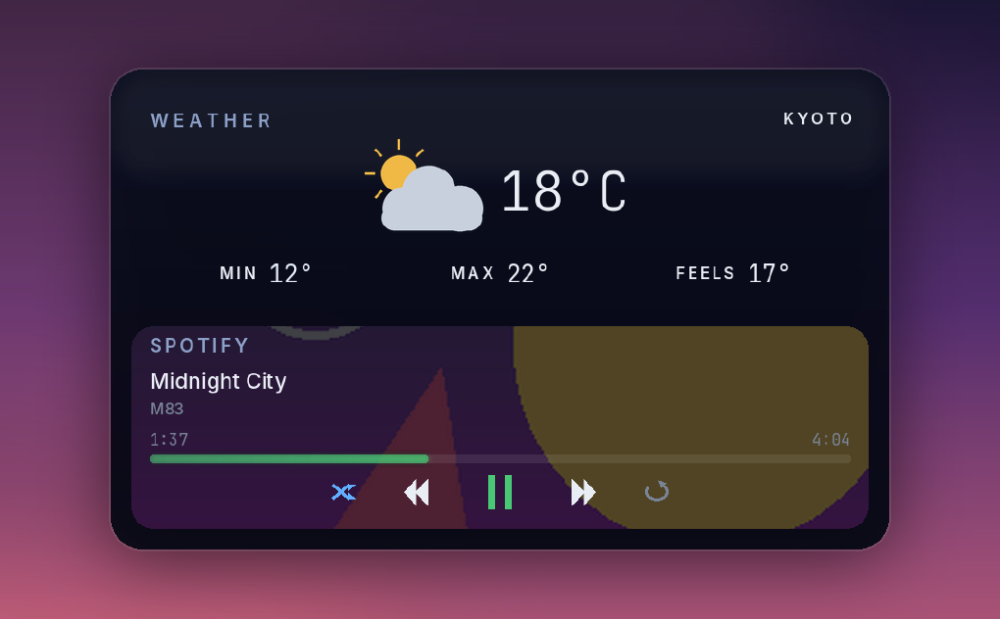

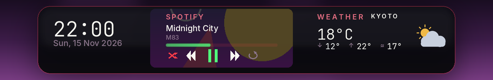

### Top processes

The top three processes by CPU usage, and the top three by memory usage.

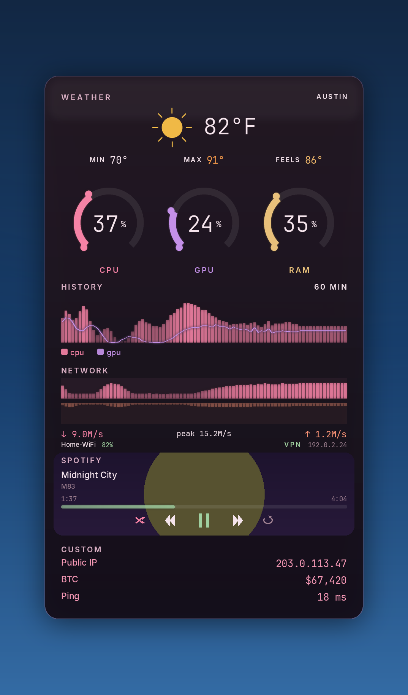

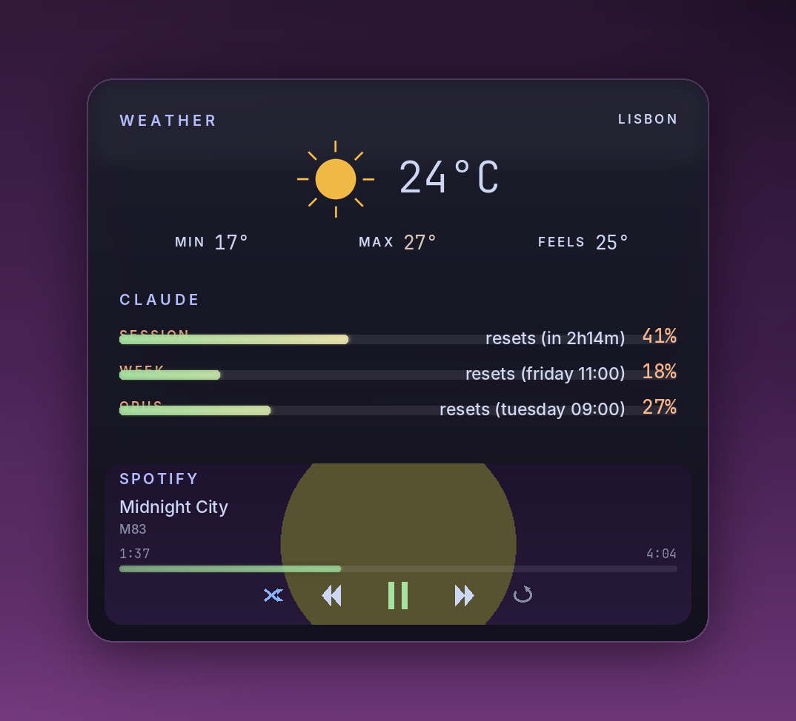

### Custom modules

Shows the output of shell commands you've configured yourself. This section
is **off by default**, even for an imported configuration — see the full
[Custom modules guide](custom-modules.md) for the four output types, the
built-in catalog, and security notes.

## Multiple panels

Run as many panels as you like. In the **Panels** group:

- **Add** creates a fresh panel with every section switched on.
- **Duplicate** makes a true copy of the panel you're currently editing,
  automatically named, including all of its sections, order, appearance and
  settings.
- **Remove** deletes a panel.
- Give each panel a **name** so you can tell them apart in the Panels list.

Every panel keeps its **own** sections, order, disks, sensors, devices,
temperature unit, weather location(s), size, position, theme and
appearance — nothing is shared between panels except the global groups
(gauge names, alerts, custom module *definitions*). This is what lets you
put a full readout on your main monitor and a slim glance panel on a
second one.

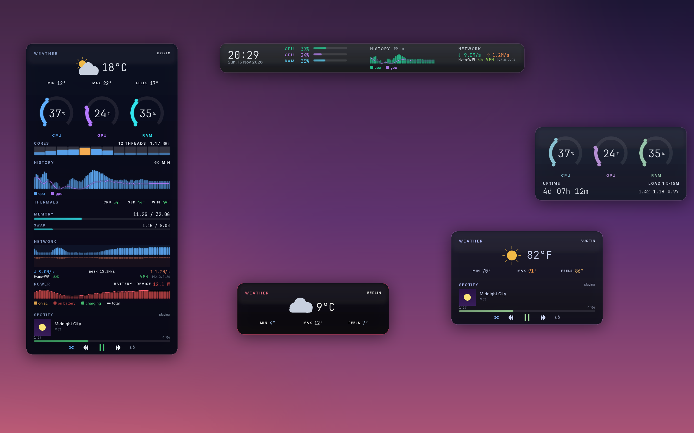

## Horizontal layout

*New in 2.0.* Each panel has its own **Horizontal layout** toggle, in
**Position & size**. Switching it on lays that panel out as a **thin bar
across the top of the screen**, with sections arranged left-to-right in a
compact form — ideal as a top-of-screen status bar rather than a sidebar.

Horizontal columns use **stable, fixed widths**, so the bar never reflows or
jitters as values change width (e.g. a network speed going from one digit
to three).

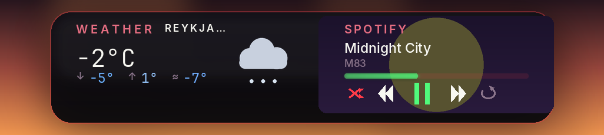

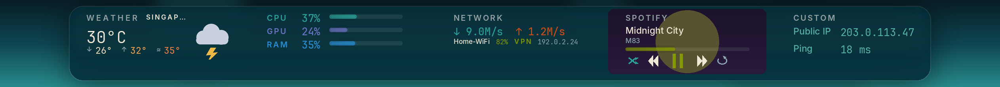

Horizontal layout is independent of theme and appearance — pick it per
panel regardless of which theme that panel uses.

## Placing & sizing

In **Position & size**:

- **Move panel…** puts the panel into an interactive move mode — drag it
  anywhere on screen, and it stays exactly where you drop it (WYSIWYG).
- Drag the panel's **corner grip** to resize it. **Width** is yours to set
  freely; **height follows the content** — dragging the panel taller simply
  spreads its sections apart rather than stretching them.
- **Reset all to top-right** puts every panel back in the default top-right
  corner position, useful if a panel has drifted off-screen or you just want
  a clean slate.
- The **Horizontal layout** toggle described above also lives in this
  group.

## Themes and appearance

*All of this is per panel* — two panels can run completely different
themes side by side.

### Themes

19 built-in themes: Midnight (the default), Obsidian, Graphite, Nord,
Dracula, Matrix, Daylight (light), Gruvbox, Catppuccin, Solarized, Solarized
Light, Onyx, Slate Mono, Rose Dusk, Neon Noir, Umber, Sandstone, Transparent,
and Wallpaper.

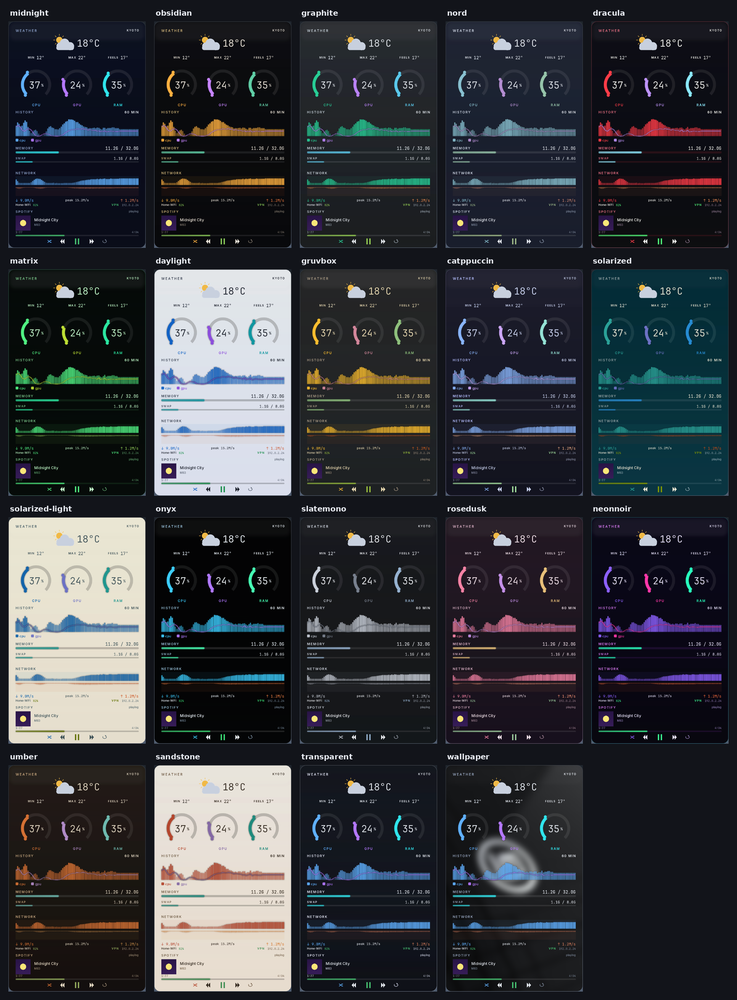

**Transparent** shows the desktop straight through the panel (30% opacity
by default). **Wallpaper** frosts your actual desktop background — or any
image you choose — behind the panel.

Switching theme adopts that theme's own look (opacity, glow, border
strength, corner radius) while **keeping** your current accent colour,
background image and panel size — so retheming never throws away the
customisation you've done.

### Appearance group

Per panel:

- **Theme** — pick one of the 19 themes above.
- **Background mode** — glass, solid, transparent, or image.
- **Accent colour** — a preset swatch, or a custom colour.
- **Opacity**, **corner rounding**, **outline strength**, **top-edge glow**,
  **text contrast** — fine control over the panel's look.
- **Size** — scales the *whole* panel: fonts, gauges and layout together.
  (For scaling just the text, see the [Text group](#text-group-new-in-20)
  below.)
- **Background image** — pick an image, with **blur**, **image size/zoom**
  (down to as little as 5%), and **repeat/tile** controls.
- **Reset to theme defaults** — clears *every* appearance override on this
  panel (accent colour, opacity, glow, border, radius, background mode/image,
  size, and the Text group's text size and per-role colours, contrast) so it
  follows the theme again. This is different from *switching theme*, which
  keeps your accent, background image and size — see
  [Themes and appearance](#themes-and-appearance). Your sections, order,
  position and weather are left alone.

### Text group *(new in 2.0)*

Also per panel, and separate from the main Appearance group:

- **Text size** — a scale from **75% to 140%** that resizes *only the
  lettering*, independent of the panel's overall **Size**. It's designed to
  stay clean across that whole range; going further would start to overflow
  the panel's fixed layout, which is why it's capped at 140%.
- **Per-role text colours** — one colour picker for each text role, each
  offering **a preset swatch, a Custom… colour, or "Theme default"**:
  - **Titles**
  - **Values / data**
  - **Subtitles / muted**
  - Plus the data **accent colours**: GPU (violet), RAM (teal), Pink,
    Upload (coral), Amber, Good (green), Alerts (red), Warning, Critical,
    Dark red.

  Every role follows the current theme until you explicitly override it, so
  you can change just one colour (say, make "Good" a brighter green) and
  leave everything else theme-controlled.

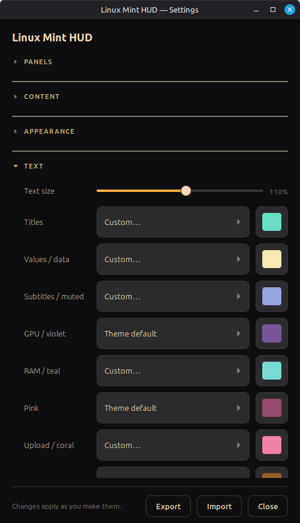

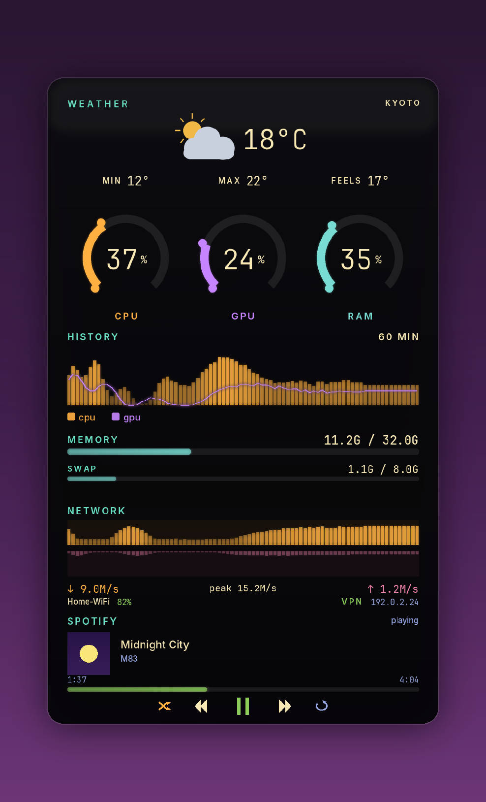

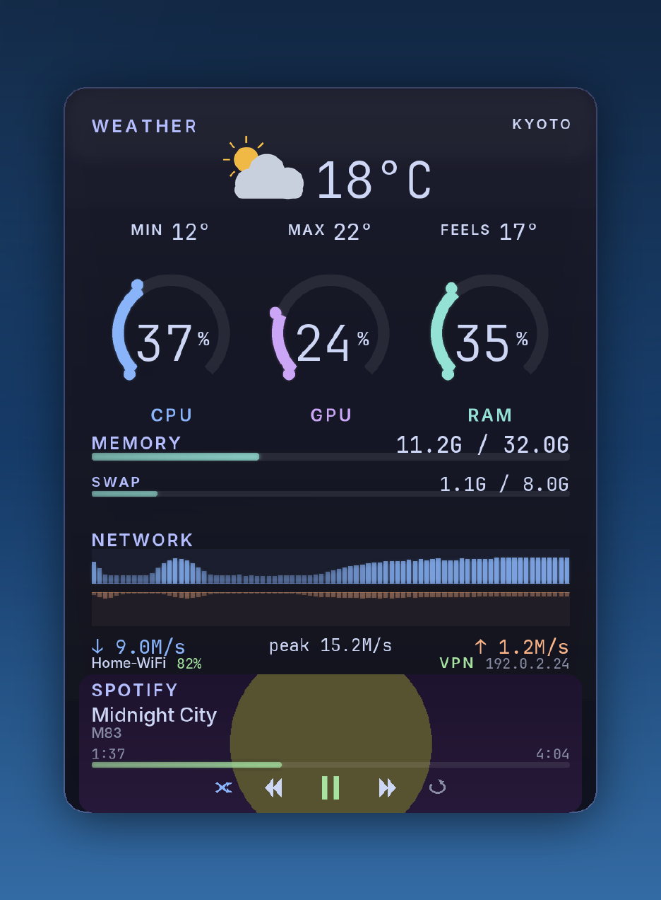

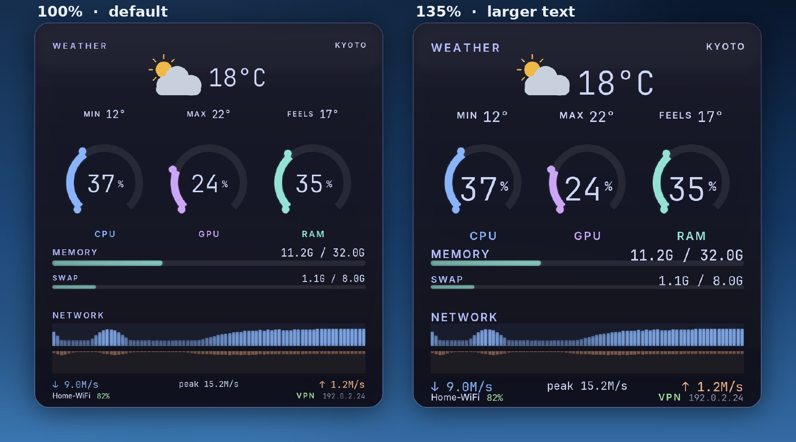

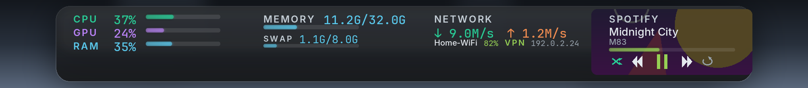

## Weather

*Multiple locations are new in 2.0.* Weather auto-detects your location on
first run. Per panel, in the **Weather** group:

- Add **several cities**, and set **"Rotate every N s"** to have the panel
  cycle through them automatically.
- **US cities default to °F**; other locations default to °C, and you can
  override the unit.
- **Show name** can be toggled off to hide the location's name and just
  show the icon and numbers.

The horizontal weather module (in [horizontal layout](#horizontal-layout))
shows the temperature with a compact `↓low ↑high ≈feels` line and the sky
icon to the right, to fit the thin bar format.

Weather data comes from [open-meteo](https://open-meteo.com) — no API key,
no account.

## Claude quota

Reads your claude.ai plan usage directly, using the session cookie from a
browser you're logged into (Firefox and its forks, or a Chromium-family
browser). There are no keys to enter. The cookie is cached locally at
`~/.config/mint-hud/.claude_web_cookie` (permissions `600`) and never leaves
your machine except to talk to claude.ai itself.

With no Claude login anywhere the panel can find, the top slot simply shows
weather instead — nothing breaks, nothing nags you to log in.

If your browser isn't one of the supported ones (or cookie detection isn't
working for your setup), you can hand the panel the cookie once by hand —
see [Setting the Claude cookie by hand](claude-cookie.md). For the privacy
details, see the [FAQ](faq.md#what-about-the-claude-cookie--is-that-private).

## Clock group

Per panel: 12-hour or 24-hour time, whether to show seconds, and a choice
of date formats.

## Temperatures group

Per panel: rename any detected sensor to something friendlier (e.g. "SSD"
instead of a raw sensor label), and pick which detected sensors to show on
that panel's Thermals line.

## Disks group

Per panel: choose one disk (the default) or several mounted filesystems to
show usage for.

## Device batteries group

Per panel: add the wireless devices (mouse, keyboard, headset, …) you want
tracked, and name them. See [Devices](#devices) above for how disconnected
devices behave.

## Global settings

Below the **"APPLIES TO ALL PANELS"** divider, these apply everywhere at
once rather than to one panel:

- **Gauge names** — naming applied across all panels' gauges.
- **Alerts** — the alert configuration that the [tray menu](tray.md)'s
  Alerts checkbox mutes and unmutes.
- **Custom modules** — define, import and export your module definitions.
  See the full [custom modules guide](custom-modules.md); note that
  *selecting* and *ordering* which defined modules show on a given panel is
  still a per-panel setting, found in that panel's own Custom modules group.

## Export, Import, Close

The action bar at the bottom of the Settings window:

- **Export** — writes your whole configuration (every panel, plus the
  global custom module definitions) to a file, for backup or to share.
- **Import** — reads a configuration file back in. Imported custom modules
  never run automatically — the Custom modules section stays off until you
  turn it on for a panel, and you should review any commands before you do;
  see [Security](custom-modules.md#security).
- **Close** — closes the Settings window. Since changes apply live as you
  make them, there's nothing to lose by closing early.
