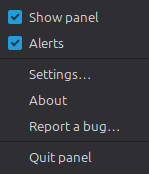

# Tray menu

Because the panel is **click-through** — clicks on it fall straight to the
desktop underneath — it can't have its own buttons or a right-click menu of
its own. The **system tray icon** is the way back into the app: it's where
you hide/show panels, mute alerts, and get to Settings.

See also: [App guide](guide.md) · [FAQ](faq.md) · [README](../README.md)

## Opening the menu

**Right-click** the tray icon to open its menu (left-click is reserved for
the Settings shortcut below). The menu has six entries:

| Entry | What it does |
|---|---|
| **Show panel** (checkbox) | Hides or shows **all** panels at once. Useful for a quick "get this out of the way" without quitting. |
| **Alerts** (checkbox) | Mutes or unmutes alerts. |
| **Settings…** | Opens the Settings window. |
| **About** | Opens the project's page and README on GitHub in your browser. |
| **Report a bug…** | Opens the project's GitHub issues page in your browser, to search existing reports or file a new one. |
| **Quit panel** | Exits the application entirely, closing every panel. |

## Left-click shortcut

**Left-clicking** the tray icon directly opens **Settings** — equivalent to
opening the menu and choosing **Settings…**, just one click instead of two.

## No tray icon?

Not every desktop environment or configuration provides a system tray area.
If yours doesn't, the tray icon is **skipped silently** — the app doesn't
fail or show an error, it just doesn't have anywhere to put an icon.

If that's your situation, reach Settings a different way: open
**Linux Mint HUD — Settings** from your application menu. That opens the
same Settings window (and starts the panel if it isn't already running), so
you still have full access to everything the tray menu would have given
you, apart from the quick Show panel / Alerts toggles and the About
shortcut (you can always open the project's GitHub page yourself instead).

For installation and menu-entry details, see the
[installation guide](installation.md).
